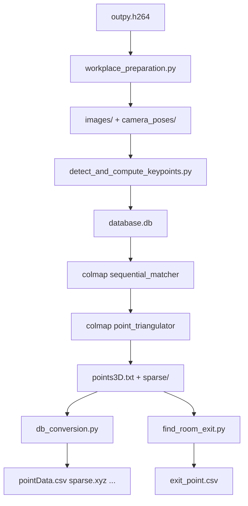

# colmap_lite_version

> **Repository:** [rbdlabhaifa/colmap_lite_version](https://github.com/rbdlabhaifa/colmap_lite_version)

## What is this project?

**colmap_lite_version** is an **ORB-based Structure-from-Motion pipeline** optimized for **weak CPUs** (Raspberry Pi Zero / RPi-class boards). It wraps a **vendored COLMAP** and **Ceres Solver** with a Python ORB frontend so feature extraction and matching run faster than stock COLMAP SIFT on embedded hardware.

The project was developed at the **RBD Lab, University of Haifa** as a practical SfM path for drone room scans (Tello + Pi camera → `.h264` video → sparse 3D map → RBD export formats → room exit detection).

It is based on [COLMAP](https://github.com/colmap/colmap) (BSD license). If you use COLMAP in research, cite the Schönberger CVPR/ECCV papers listed in the [License](#license) section.

## What does it do?

1. **Ingest video** — Takes an `outpy.h264` capture (640×480, Tello/Pi workflow).
2. **Extract frames** — ffmpeg splits the video into **87** JPG frames (+ a **10**-frame temp model for pose priors).
3. **ORB features in Python** — OpenCV ORB + custom sequential/quadratic matching writes a COLMAP `database.db` (lighter than SIFT on-device).
4. **Fixed-pose triangulation** — Uses precomputed relative poses (`ref_camera_pose.h5`) + `colmap point_triangulator` instead of full incremental mapping.
5. **Export for RBD stack** — `pointData.csv`, `descriptorsData.xml`, `sparse.xyz`, plots.
6. **Room exit** — `Find_exit/find_room_exit.py` estimates an exit point from the sparse model.

**Demo video:** [`lite_colmap_demo.mp4`](lite_colmap_demo.mp4) — screen recording of the pipeline (~2.5 min).

**Typical workflow:**

```bash
git clone https://github.com/rbdlabhaifa/colmap_lite_version.git
cd colmap_lite_version
# Build Ceres + COLMAP (install.rst)
pip install -r requirements.txt
cp config.yaml.example config.yaml

# One-time calibration (Orb_version/)
cd Orb_version
python3 camera_pose_preparation.py -p /path/to/empty/workspace/with/outpy.h264

# Production reconstruction
./colmap_bash.sh -p /path/to/workspace
```

See **[demos/README.md](demos/README.md)** for sample data under `Models/`.

---

# 1. Project Overview

**Problem solved:** Run SfM on a Raspberry Pi–class device where full COLMAP SIFT + mapper is too slow.

**Approach:** Precompute camera pose priors once (`ref_camera_pose.h5`), then on each new scan use **Python ORB** for features/matching and **`point_triangulator`** for sparse reconstruction — skipping the heaviest mapper stages on the device.

**Primary users:**

| Audience | How they use it |
|---|---|
| **Lab students / operators** | Scan a room with Tello+Pi, run `colmap_bash.sh` |
| **Developers** | Tune ORB matching in `detect_and_compute_keypoints.py` |
| **Downstream RBD tools** | Consume `pointData.csv`, `sparse.xyz`, `exit_point.csv` |

**What it is not:** a general COLMAP replacement, dense MVS pipeline, or maintained fork of upstream COLMAP.

---

# 2. Architecture & Tech Stack

| Layer | Technology |
|---|---|
| SfM core | Vendored **COLMAP** (`colmap/`) |
| Optimization | Vendored **Ceres Solver** (`ceres-solver/`) |
| ORB frontend | Python 3 + OpenCV (`Orb_version/*.py`) |
| Database | COLMAP SQLite schema (`colmap_database.py`) |
| Exit detection | Python (`Orb_version/Find_exit/`) |
| Optional capture | `scan_script.py` + `djitellopy` + PiCamera |
| Shell orchestrator | `Orb_version/colmap_bash.sh` |



**Lite vs full COLMAP:** ORB path avoids SIFT extraction and full `mapper` on the Pi; poses come from `ref_camera_pose.h5` + temp 10-frame COLMAP model.

---

# 3. Prerequisites

## System (Ubuntu recommended)

From [install.rst](install.rst):

```bash
sudo apt-get install \
  git cmake build-essential \
  libboost-program-options-dev libboost-filesystem-dev \
  libboost-graph-dev libboost-system-dev libboost-test-dev \
  libeigen3-dev libsuitesparse-dev libfreeimage-dev \
  libgoogle-glog-dev libgflags-dev libglew-dev \
  ffmpeg
```

Build and install **Ceres** and **COLMAP** from the vendored trees:

```bash
cd ceres-solver && mkdir -p build && cd build
cmake .. -DBUILD_TESTING=OFF -DBUILD_EXAMPLES=OFF && make -j$(nproc) && sudo make install

cd ../../../colmap && mkdir -p build && cd build
cmake .. && make -j$(nproc) && sudo make install
colmap -h   # verify
```

## Python

```bash
pip install -r requirements.txt
```

Key packages: `opencv-python`, `numpy`, `deepdish` (for `ref_camera_pose.h5`), `matplotlib`, `scipy`, `scikit-learn`.

## Hardware target

- Raspberry Pi Zero / weak ARM board for **capture + ORB path**
- Linux workstation acceptable for **one-time** `camera_pose_preparation.py` (runs full COLMAP)

---

# 4. Environment Setup

## Clone

```bash
git clone https://github.com/rbdlabhaifa/colmap_lite_version.git
cd colmap_lite_version
```

## Configuration

No `.env` file. Optional reference config:

```bash
cp config.yaml.example config.yaml
```

| Key | Purpose |
|---|---|
| `workspace_path` | Folder containing `outpy.h264` (empty except video before run) |
| `repo_root` | Path to this clone |
| `use_orb_version` | Documented preference; toggle in `colmap_bash.sh` |

**Critical runtime file:** `Orb_version/ref_camera_pose.h5` — run `camera_pose_preparation.py` once per camera/setup, from the **`Orb_version/`** directory (script loads the HDF5 from CWD).

**Camera intrinsics:** Hardcoded 640×480 OpenCV model in `detect_and_compute_keypoints.py`; see `Orb_version/Results640x480.txt`.

---

# 5. Build & Run Instructions

## One-time pose calibration

```bash
cd Orb_version
python3 camera_pose_preparation.py -p /path/to/workspace
# workspace: empty except outpy.h264
# Interactive prompts → updates ref_camera_pose.h5 in Orb_version/
```

## Production reconstruction

```bash
cd Orb_version
chmod +x colmap_bash.sh
./colmap_bash.sh -p /path/to/workspace
```

**Expected outputs** in workspace (see `Models/Full model example/`):

- `images/`, `camera_poses/`, `database.db`
- `points3D.txt`, `images.txt`, `sparse/`
- `pointData.csv`, `descriptorsData.xml`, `sparse.xyz`, `sparse_plot.png`
- `exit_point.csv`, `sfm_log.txt`

## Tests / linters

None configured. Compare outputs and timings to `Models/Full model example/sfm_log.txt` (~71 s reference).

---

# 6. Repository Structure

```
colmap_lite_version/
├── lite_colmap_demo.mp4       # Demo screen recording
├── install.rst                # Ceres + COLMAP build instructions
├── config.yaml.example
├── requirements.txt
├── demos/README.md
├── Models/
│   ├── Full model example/    # ★ Golden output workspace
│   ├── video1/ video2/ video3/  # Sample .h264 inputs
├── Orb_version/               # ★ Application pipeline
│   ├── colmap_bash.sh         # Main entry point
│   ├── workplace_preparation.py
│   ├── detect_and_compute_keypoints.py
│   ├── db_conversion.py
│   ├── camera_pose_preparation.py
│   ├── ref_camera_pose.h5
│   └── Find_exit/
├── colmap/                    # Vendored COLMAP source
├── ceres-solver/              # Vendored Ceres
├── colmap_profiling/          # Manual Callgrind notes
└── djitellopy/                # Tello SDK (optional capture)
```

---

# 7. Core Workflows & Data Flow

## Happy path

1. **`scan_script.py`** (optional) — Pi records `outpy.h264` via Tello maneuver.
2. **`camera_pose_preparation.py`** (once) — full COLMAP recon → `ref_camera_pose.h5`.
3. **`colmap_bash.sh -p WORKSPACE`**:
   - `workplace_preparation.py` — ffmpeg → 87 frames, build `camera_poses/`
   - `detect_and_compute_keypoints.py` — ORB → `database.db`
   - `colmap sequential_matcher`
   - `colmap point_triangulator`
   - `db_conversion.py` — RBD formats
   - `find_room_exit.py` — `exit_point.csv`

**Read first:** `Orb_version/colmap_bash.sh` → `workplace_preparation.py` → `detect_and_compute_keypoints.py`.

---

# 8. Deployment & CI/CD

**Deployment:** Build on target Pi or cross-build COLMAP on a workstation and copy binaries. Run reconstruction on-device with workspace on local storage.

**CI/CD:** None. `ceres-solver/.travis.yml` is upstream vendor only.

---

# 9. Known Quirks & Technical Debt

| Issue | Impact |
|---|---|
| **`ref_camera_pose.h5` tied to Orb_version CWD** | Must run pose prep from `Orb_version/` or copy/symlink the file |
| **Hardcoded 640×480 intrinsics** | Wrong camera → bad triangulation |
| **87 / 10 frame counts fixed** | Changing video length requires code edits |
| **Vendored COLMAP/Ceres are old** | Security/build fixes need manual merge from upstream |
| **`find_room_exit.py` expects TXT at workspace root** | Copy from `sparse/0/` if missing |
| **Large vendored trees + demo MP4** | Clone is ~200MB+ |

---

# 10. Troubleshooting / FAQ

### 1. `colmap: command not found`

Build and `sudo make install` COLMAP from `colmap/build`, verify with `colmap -h`.

### 2. `FileNotFoundError: ref_camera_pose.h5`

Run `camera_pose_preparation.py` from **`Orb_version/`** first, or copy an existing `ref_camera_pose.h5` there.

### 3. ffmpeg / ffprobe errors

Install ffmpeg: `sudo apt-get install ffmpeg`. Workspace must contain **`outpy.h264`**.

### 4. Empty or bad sparse model

- Confirm video overlap and exposure (Tello scans need good lighting)
- Re-run pose preparation if camera or resolution changed
- Check intrinsics in `Results640x480.txt` match your capture

### 5. `deepdish` / HDF5 errors

```bash
pip install deepdish tables
```

---

## License

COLMAP components are under the **BSD license** (see original README block). This repository vendors COLMAP and Ceres; dependency licenses apply separately.

Upstream COLMAP: https://github.com/colmap/colmap  
Upstream Ceres: https://ceres-solver.googlesource.com/ceres-solver

## Related RBD Lab projects

[simulatorMapping](https://github.com/rbdlabhaifa/simulatorMapping) · [LidarDrone](https://github.com/rbdlabhaifa/LidarDrone) · [RBD-SLAM](https://github.com/rbdlabhaifa/RBD-SLAM) · [SFM-SLAM](https://github.com/rbdlabhaifa/SFM-SLAM)

## Citation

If you use COLMAP, cite:

```bibtex
@inproceedings{schoenberger2016sfm,
  author={Sch\"{o}nberger, Johannes Lutz and Frahm, Jan-Michael},
  title={Structure-from-Motion Revisited},
  booktitle={CVPR}, year={2016},
}
```
